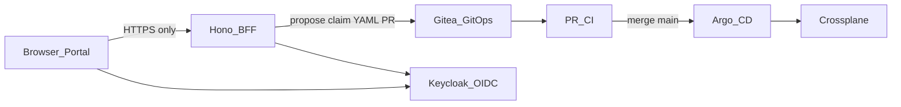

# Case study 01 — GitOps IDP / Crossplane platform

**Positioning:** Internal developer platform (IDP) learning system with a contract-first portal and a local control plane.

**Private origin (sanitized):** personal `crossplane_idp` monorepo — patterns only; no secrets, hostnames-as-credentials, or proprietary claim catalogs.

## Problem

Teams that let portals (or agents) write Kubernetes resources directly create:

- Unreviewable cluster mutations
- Drift between “desired” and Git
- Weak audit trails for who requested what

Agents amplify this: a model with `kubectl apply` is an unbounded change agent.

## Architecture (C4 context)

**Intent flow:** propose claim → PR CI green → merge → Argo sync → Crossplane Ready.

**Hard rule:** the browser talks **only** to the BFF. Shared DTOs live in a contracts package (Zod). Crossplane claims are never created by the SPA.

## Stack sketch

| Layer | Choices |
|-------|---------|
| Portal | React + BFF (Hono) |
| Contracts | Shared Zod / typed DTOs |
| Control plane | k3d + Gitea + Argo CD + Crossplane + Keycloak |
| Edge | Configurable base domain; Ingress per service |
| Modes | `mock` / `lite` / prod-shaped portal |

## ADRs (summaries)

See [ADR-001](../adrs/ADR-001-bff-only-browser.md), [ADR-002](../adrs/ADR-002-gitops-claims-not-direct-apply.md), [ADR-003](../adrs/ADR-003-contract-first-dtos.md).

## Threat-model excerpt

| Threat | Mitigation |
|--------|------------|
| SPA holds cluster credentials | No kubeconfig in browser; BFF + GitOps only |
| Agent invents claim YAML and applies | Propose-to-Git only; Argo syncs merged `main` |
| Token audience confusion (OIDC) | Validate `azp` / allowed client IDs; in-cluster JWKS for in-cluster BFF |
| Secrets in Git | Never commit tokens; platform secrets via sealed/external patterns |

## What I would change at company scale

1. **Multi-tenant isolation** — org/project namespaces, admission policies, and quota XRDs as first-class products.
2. **Policy-as-code** — OPA/Kyverno gates on claim PRs before merge.
3. **Platform SLOs** — time-to-Ready for claims; golden-path success rate; drift alerts.
4. **Agent surface** — expose only “propose PR” tools with schema validation; never raw apply.

## Golden path (&lt;30 min target)

Documented operator flow: install tooling → `mock-up` health → optional `bootstrap` control plane → propose a namespace/app claim → watch Argo → Ready. Exact scripts stay in the private monorepo; this case study owns the **decision narrative**.
