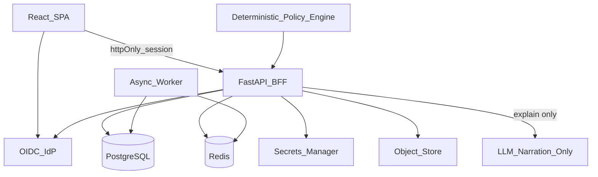

# Case study 02 — Agent-safe product architecture

**Positioning:** High-stakes product domain where AI assists analysis but **never** becomes an autonomous operator.

**Private origin (sanitized):** personal portfolio-intelligence / “Personal CFO” patterns — no balances, account numbers, brokerage tokens, or PII.

## Problem

Agentic demos often optimize for “the model can do anything.” In capital, health, or infra-adjacent products that is a liability:

- Silent autonomous side effects
- LLM as sole decision-maker
- Secrets in browser storage
- No human approval gate

## Architecture (C4 context)

## Non-negotiable guardrails (product architecture)

1. **Read-first, act-last** — integrations default read-only.
2. **Human approval for irreversible actions** — enumerate every underlying operation; dual confirm above threshold.
3. **Least privilege** — min OAuth scopes; encrypt tokens at rest; decrypt only in trusted API/worker identity.
4. **Tokens never** in frontend, logs, analytics, or `localStorage`.
5. **Explainability** — deterministic policy owns recommendations; **LLM narrates only**.
6. **Fail-closed** defaults — live execution flags off until explicit enrollment.
7. **Do not train** foundation models on private ledger data.

## ADRs (summaries)

See [ADR-004](../adrs/ADR-004-policy-over-llm.md), [ADR-005](../adrs/ADR-005-bff-session-cookies.md), [ADR-001](../adrs/ADR-001-bff-only-browser.md).

## Threat-model excerpt

| Asset | Threat | Control |
|-------|--------|---------|
| Brokerage/API tokens | Exfiltration via XSS | httpOnly cookies; no token to SPA |
| Irreversible actions | Autonomous agent submit | Feature flag + dual human confirm |
| PII / ledger | Model training leakage | Explicit “no train” policy; redaction |
| Recommendations | Hallucinated “advice” | Policy engine + educational labeling |

## Stack sketch

React/Vite SPA · FastAPI BFF · async workers · PostgreSQL · Redis · OIDC · secrets manager · object storage · optional Helm/k3d deploy stubs.

## What I would change at company scale

1. Formal **model risk** reviews and eval gates before any tool that can mutate money/state.
2. **OpenTelemetry** spans for every tool call + decision path (policy vs narration).
3. Multi-persona RBAC (owner, advisor-read-only, auditor).
4. Paper/sim environments as a first-class product mode, not an afterthought.

## Interview soundbite

> “I design agents as narrators and copilots behind a BFF and a policy engine. Autonomy is opt-in, audited, and human-gated—especially when side effects are irreversible.”
