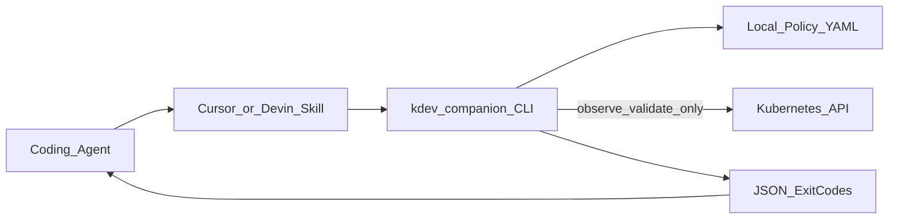

# Case study 03 — Deterministic Kubernetes companion for agents

**Positioning:** Workstation-side CLI that gives coding agents **safe, bounded** Kubernetes observation and validation—without becoming an in-cluster operator or an auto-calling LLM wrapper.

**Public intent:** patterns suitable for open tooling; companion implementation may remain private until sanitized for release.

## Problem

Agents with raw cluster access fail in predictable ways:

- Polling loops that burn API quota
- Undocumented `kubectl` mutations
- Ambiguous success/failure for automation
- Mixing “AI opinion” with “cluster fact”

## Design principles

1. **Deterministic observation** — structured checks, not free-form chat about the cluster.
2. **Bounded local jobs** — timeouts and exit codes as contracts.
3. **Sanitized exports** — redaction before anything leaves the machine.
4. **No automatic model calls** from the CLI itself.
5. **No in-cluster operator / CRD** for MVP — stays on the workstation.
6. **Change/apply modes disabled** until explicitly designed and authorized.

## Architecture

### Exit-code contract

| Code | Meaning |
|------|---------|
| 0 | Passed |
| 1 | Failed check |
| 2 | Unknown / unsupported / prerequisite missing |
| 3 | Policy or authorization refusal |
| 4 | Timed out |

Agents can branch on codes without parsing prose.

## ADRs (summaries)

See [ADR-006](../adrs/ADR-006-workstation-not-operator.md), [ADR-007](../adrs/ADR-007-exit-codes-as-api.md), [ADR-008](../adrs/ADR-008-optional-mcp-adapter.md).

## Threat-model excerpt

| Threat | Mitigation |
|--------|------------|
| Agent gains write via helper | Apply/change not implemented in MVP |
| Policy file commits secrets | Policy gitignored; examples are offline fixtures |
| Over-broad RBAC | Document least-privilege ClusterRole for observe |
| Prompt injection via cluster objects | Structured output; no “execute this annotation” path |

## Skill / MCP boundary

- **Skills** teach agents *when* and *how* to invoke the CLI.
- Optional **MCP adapter** (design-only until needed) wraps the same deterministic commands—never invents new mutate tools.

## What I would change at company scale

1. Signed policy packs per environment (dev/stage/prod).
2. Central allow-list of check packs; org-wide exit-code semantics.
3. Audit log of companion invocations shipped to SIEM.
4. Pair with GitOps IDP so agents propose changes via PRs, not live apply.

## Interview soundbite

> “I make infrastructure safe for agents by giving them a boring, typed CLI with exit codes—not another chatbot with kubeconfig.”
