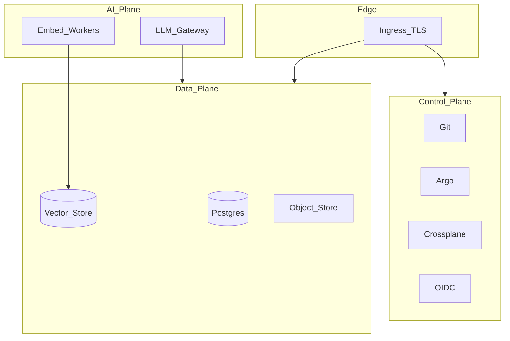

# SLOs, failure domains, and cost — IDP + RAG stacks

Portfolio ops narrative for architect interviews. Numbers are **illustrative targets** for a learning/lab platform, not production SLAs from a client engagement.

## Failure domains

Isolate blast radius: a vector-store outage must not take down OIDC login; a model provider outage must degrade to “search only,” not 500 the portal.

## Suggested SLOs (lab → prod trajectory)

| Service | SLI | Lab target | Notes |
|---------|-----|------------|-------|
| IDP portal BFF | Availability | 99.5% | Exclude planned teardown |
| Claim Ready | Latency p95 propose→Ready | &lt; 15 min | Dominated by image pulls in lab |
| RAG ask | Success rate | 99% | Exclude provider 429s with backoff |
| RAG ask | Latency p95 | &lt; 8s | With warm embeddings |
| Auth | Login success | 99.9% | IdP is shared dependency |

**Error budget:** for 99.5% monthly availability ≈ 3.6h; burn alerts at 50% budget in 1h / 24h windows.

## Cost drivers (RAG + IDP)

| Driver | Lever |
|--------|-------|
| LLM tokens | Cache summaries; smaller models for routing; refuse oversized contexts |
| Embedding recompute | Content-hash skip; batch offline |
| GPU/Ollama hosts | Size for evals, not always-on prod chat |
| k3d node count | Tear down when idle; document `teardown` |
| Object storage | Lifecycle rules on raw uploads |

## Cost-per-task sketch (agent eval)

Track for every eval run:

- Input/output tokens
- Tool calls count
- Wall time
- Outcome: pass / refuse / fail

Reject “smart” agents that burn 10× tokens for +2% task success without a product reason.

## Runbooks (titles only)

1. IdP down — read-only banner; no claim proposes
2. Vector store down — keyword fallback or 503 with retry-after
3. GitOps stuck — Argo app health + last sync diff
4. Provider 429 — exponential backoff; shed non-critical narration
